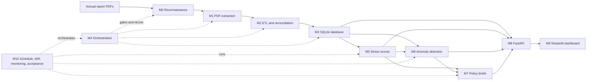

# DARPAN

**Banking Ombudsman report analytics prototype**

DARPAN turns RBI Banking Ombudsman annual-report PDFs into a traceable dataset, exploratory bank-group stress indicators, anomaly flags, and policy-brief drafts. It is an analyst-support prototype, not an RBI product or a regulatory rating system.

## Problem and users

The primary users are banking supervisors, complaint-analysis teams, and policy researchers who compare complaint patterns across banks and reporting years. Before a consolidated workflow, the evidence is distributed across long annual-report PDFs whose table layouts and labels change over time. Analysts must find comparable tables manually, reconcile names and categories, and preserve the path from a reported number back to its source page.

## What it does

- **Reconnaissance and extraction:** inventories PDFs, records format eras, and extracts native-text tables with document/page provenance.
- **ETL and database:** retains raw tables, reconciles supported labels into a canonical SQLite schema, and keeps ambiguous inputs visible for review.
- **Stress and anomaly analysis:** calculates explainable, data-dependent stress components and annual-volume anomaly flags.
- **Policy briefs:** creates fixed-section briefs from precomputed values; the brief generator does not calculate or invent metrics.
- **API and dashboard:** serves bank, stress, trend, peer, anomaly, and brief views through FastAPI and Streamlit, with scheduled pipeline operations and drift checks.

## Architecture



- **M0–M1:** inventory, format-era decisions, text/table extraction, and source references.
- **M2–M3:** schema reconciliation, normalized fact data, and SQLite persistence.
- **M4–M7:** orchestration, stress indicators, anomaly detection, and briefs.
- **M8–M9:** read API and analyst dashboard.
- **M10:** scheduled execution, drift gating, health checks, alerts, and acceptance reports.

## Key decisions

- **Traceability over silent guessing:** raw tables remain in staging; exact dimension matches are required for normalized facts. Ambiguous tables are rejected for review instead of being assigned guessed entities.
- **Native text before OCR:** all nine PDFs in the current corpus have usable text layers. M1 uses pdfplumber and a Camelot fallback for pages where table extraction needs another native-text parser. OCR routing is not implemented because no current source required it.
- **Rules before complex models:** M5/M6 use interpretable scores and statistical thresholds. STL decomposition, the `ruptures` library, and isolation forest are not implemented in this prototype.
- **Numbers are deterministic:** M7 currently uses templates and precomputed M5/M6 outputs; it does not call an LLM. Qwen2.5:3B was not used or shipped. Any future narrative model must not calculate or create metric values.
- **Missing evidence stays missing:** financial normalization, disposal quality, and several other components are unavailable where source facts are absent. M5 lowers confidence and omits unsupported components rather than filling them with estimates.
- **SQLite for the prototype:** M3 uses a local SQLite database. PostgreSQL and a read replica remain deployment options, not current implementation.

## Results

Measured by the latest successful containerized M0–M7 run:

| Measure | Result |
|---|---:|
| Annual reports inventoried | 9 (FY 2016-17 to FY 2024-25) |
| PDFs with native text / OCR-only PDFs | 9 / 0 |
| M1 extracted tables | 1,164 |
| M1 candidate rows emitted | 1,879 |
| M1 spot-checks passed | 9 of 9 |
| M2 staging tables / normalized facts | 1,164 / 206 |
| M2 rejected or ambiguous tables | 327 |
| M3 years covered / fact rows | 9 / 206 |
| M5 bank-group/entity scores | 8 (2 medium-confidence, 6 low-confidence) |
| M6 anomaly events | 3 |
| M7 briefs generated | 8 |
| M10 full pipeline | Passed; 0 drift changes in that run |

**Accuracy and the requested 40% figure:** the project artifacts contain no measured 40% accuracy, time-saving, or error-reduction result, and there is no independently labeled gold set or manual-time baseline. The `9/9` result is a spot-check gate pass rate (`9 / 9 x 100 = 100%`); it is **not extraction accuracy**. Do not present 40% as a measured result. If the intended claim is time saved, measure matched manual and DARPAN processing times and calculate `(manual minutes - DARPAN minutes) / manual minutes x 100`. If it is accuracy, label source values independently and calculate `correct extracted values / independently labeled values x 100`. Neither denominator is currently recorded, so a 40% claim cannot yet be reproduced.

The 206 normalized facts are exploratory and do not represent every complaint row in the reports. M2 currently records 327 ambiguous/unsupported tables for review; M5 has sparse evidence and low-confidence outputs. Scores and anomalies should not be used as official supervisory determinations.

## Challenges and handling

- **Format drift:** reports span legacy BOS, transition, and IOS layouts. M0 records era/schema variants; M2 uses era-specific adapters; M10 compares current files and schema metadata with an accepted baseline and can block critical drift.
- **OCR versus native text:** M0 found native text in all nine available PDFs, so the current run avoids OCR. Camelot is a fallback for tables missed by pdfplumber. A true scanned PDF still requires an OCR adapter; that path is not yet available.
- **Imperfect table layouts and labels:** PDF table boundaries and entity naming are inconsistent. M1 preserves extracted evidence and provenance; M2 records rejected/ambiguous tables instead of treating all extracted rows as facts.
- **Sparse data:** financial data and several resolution measures are not populated in M3. M5 reports unavailable components and confidence rather than extrapolating them.

## Tech stack

Python 3.12 container; pdfplumber; Camelot; Pydantic; pandas; SQLite; FastAPI; Uvicorn; Streamlit; Requests; Docker Compose.

## Demo

The current deployment is local Docker Compose, not a public internet deployment:

- Dashboard: [http://localhost:8501](http://localhost:8501)
- API documentation: [http://localhost:18000/docs](http://localhost:18000/docs)
- API health: [http://localhost:18000/health](http://localhost:18000/health)

Start or inspect the deployment using [CONTAINERIZATION.md](CONTAINERIZATION.md). The dashboard and API require the Compose services to be running on the same machine.

## Role and timeline

**Implementation scope in this workspace:** end-to-end prototype work across reconnaissance, extraction, ETL, database, scoring, anomaly detection, policy briefs, API, dashboard, container deployment, scheduling, and acceptance checks. The repository does not record individual authorship, so personal contribution claims should be adjusted to match the actual project team.

The original module plan estimates approximately **16 weeks** for the full program. That is a planned roadmap, not a measured elapsed development time for this prototype.

## What’s next

1. Expand the source corpus and add regression fixtures for each PDF schema era; implement and validate OCR before ingesting scanned reports.
2. Add verified bank-level DBIE financials and improve canonical bank/category matching so normalized coverage and M5 confidence can increase.
3. Add a public, access-controlled deployment and route alerts to an approved monitoring destination; evaluate any 40% efficiency/accuracy claim using a recorded baseline or independently labeled dataset.

## Run the pipeline

Build containers and run the complete pipeline from the workspace root:

```powershell
docker compose build
docker compose --profile jobs run --rm pipeline
docker compose up -d api dashboard
```

To enable the configured monthly/quarterly scheduler:

```powershell
docker compose --profile scheduler up -d scheduler
```
